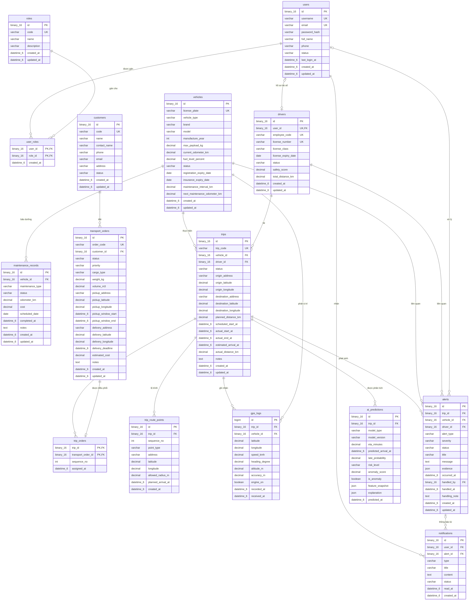

# ERD MySQL — AI-TransWatch (MVP)

> Phạm vi: schema cho ứng dụng quản lý vận tải, GPS giả lập, cảnh báo thời gian thực và kết quả phân tích AI. Backend sử dụng **Spring Boot 4 + Spring Data JPA/Hibernate**, migration bằng **Flyway**, cơ sở dữ liệu **MySQL 8**.

## 1. Quy ước thiết kế

- Tất cả khoá chính sử dụng `BINARY(16)` (UUID) và được ánh xạ JPA bằng `UUID`/`@UuidGenerator`; tránh `CHAR(36)` để tối ưu index. Flyway tạo UUID phía ứng dụng.
- Các bảng nghiệp vụ có `created_at`, `updated_at` (`DATETIME(6)`); các bảng cần truy vết cũng có `created_by`, `updated_by` (`BINARY(16)`, nullable để không tạo vòng FK với `users`). Đây là phần dùng chung từ `BaseEntity`.
- Enum JPA được lưu dạng chuỗi bằng `@Enumerated(EnumType.STRING)`; cột `VARCHAR`, không dùng MySQL `ENUM`, giúp mở rộng giá trị bằng migration an toàn hơn.
- Tên bảng/cột dùng `snake_case`; thời điểm dùng UTC, chuyển đổi múi giờ ở API/UI.
- `DECIMAL` dùng cho khối lượng, quãng đường, chi phí và xác suất; tọa độ GPS dùng `DECIMAL(10,7)`.
- Khóa ngoại mặc định `RESTRICT`; lịch sử GPS, cảnh báo, AI prediction được xóa theo `CASCADE` cùng `trips`. Không hard delete tài khoản, xe, tài xế, khách hàng đã phát sinh dữ liệu.

## 2. Mermaid ERD

## 3. Mô tả bảng và cột chính

| Bảng | Mục đích | Cột chính |
| --- | --- | --- |
| `users` | Tài khoản đăng nhập cho admin, điều phối viên và tài xế. | `id`, `username`, `email`, `password_hash`, `full_name`, `phone`, `status`, `last_login_at`. |
| `roles` | Danh mục vai trò hệ thống. Seed ba mã `ADMIN`, `DISPATCHER`, `DRIVER`. | `id`, `code`, `name`, `description`. |
| `user_roles` | Liên kết N-N người dùng–vai trò. MVP có thể chỉ gán một role, nhưng schema vẫn hỗ trợ mở rộng. | `user_id`, `role_id`; PK ghép. |
| `drivers` | Hồ sơ nghiệp vụ của tài xế, liên kết tối đa một tài khoản người dùng. | `user_id`, `employee_code`, `license_number`, `license_class`, `license_expiry_date`, `status`, `safety_score`. |
| `vehicles` | Xe vận tải và trạng thái sẵn sàng/bảo trì. | `license_plate`, `vehicle_type`, `max_payload_kg`, `current_odometer_km`, `fuel_level_percent`, `registration_expiry_date`, `insurance_expiry_date`, `status`. |
| `maintenance_records` | Lịch/sự kiện bảo dưỡng xe và chi phí. | `vehicle_id`, `maintenance_type`, `status`, `odometer_km`, `scheduled_date`, `completed_at`, `cost`. |
| `customers` | Khách hàng đặt đơn vận chuyển. | `code`, `name`, `contact_name`, `phone`, `email`, `address`, `status`. |
| `transport_orders` | Đơn vận chuyển, điểm nhận/trả, hàng hóa và hạn giao. | `order_code`, `customer_id`, `status`, `priority`, `weight_kg`, `pickup_*`, `delivery_*`, `delivery_deadline`. |
| `trips` | Chuyến xe được điều phối cùng xe, tài xế, lịch và tiến độ. | `trip_code`, `vehicle_id`, `driver_id`, `status`, `scheduled_start_at`, `actual_start_at`, `estimated_arrival_at`, `actual_end_at`. |
| `trip_orders` | Liên kết N-N giữa chuyến và đơn; `sequence_no` là thứ tự giao đơn trên chuyến. Một đơn chỉ nằm trong tối đa một chuyến chưa hủy/hoàn tất do service kiểm soát. | `trip_id`, `transport_order_id`, `sequence_no`, `assigned_at`. |
| `trip_route_points` | Điểm polyline/lộ trình dự kiến hoặc điểm dừng; dùng tính khoảng cách lệch tuyến. | `trip_id`, `sequence_no`, `point_type`, `latitude`, `longitude`, `allowed_radius_m`, `planned_arrival_at`. |
| `gps_logs` | Dữ liệu GPS bất biến nhận từ simulator/thiết bị. Do tốc độ tăng trưởng cao, dùng `BIGINT` auto-increment. | `trip_id`, `vehicle_id`, `latitude`, `longitude`, `speed_kmh`, `heading_degree`, `engine_on`, `recorded_at`. |
| `alerts` | Sự kiện cảnh báo rule-based/AI và quá trình xử lý. | `trip_id`, `vehicle_id`, `driver_id`, `alert_type`, `severity`, `status`, `evidence` (JSON), `handled_by`, `handled_at`. |
| `ai_predictions` | Snapshot đầu ra model ETA, trễ và bất thường để truy vết/đánh giá. | `trip_id`, `model_type`, `model_version`, `eta_minutes`, `late_probability`, `risk_level`, `anomaly_score`, `feature_snapshot`, `explanation`. |
| `notifications` | Thông báo trong ứng dụng/realtime theo từng người dùng. | `user_id`, `alert_id`, `type`, `title`, `content`, `status`, `read_at`. |

## 4. Quan hệ và quy tắc toàn vẹn

1. `users`–`roles` là quan hệ N-N qua `user_roles`. Không cho xóa role/tài khoản khi còn liên kết; khóa tài khoản bằng `users.status`.
2. `drivers.user_id` là `UNIQUE` và nullable: tài xế có thể được tạo trước tài khoản; một user chỉ có tối đa một hồ sơ tài xế.
3. Mỗi `trip` bắt buộc có đúng một `vehicle` và một `driver`; một xe/tài xế có nhiều chuyến theo lịch sử. Service kiểm tra không trùng khoảng vận hành khi lập chuyến.
4. `transport_orders` và `trips` là N-N qua `trip_orders`; `UNIQUE(trip_id, sequence_no)` bảo toàn thứ tự giao trong chuyến.
5. `gps_logs` luôn thuộc một `trip` và xe của chuyến. Ràng buộc xe khớp chuyến thực hiện tại service hoặc trigger (MVP chọn service để JPA dễ quản lý).
6. `alerts` có thể chỉ tham chiếu một trong `trip_id`, `vehicle_id`, `driver_id`; cảnh báo hành trình thường tham chiếu cả ba. `handled_by` là user xử lý, có thể null khi trạng thái `NEW`.
7. `ai_predictions` là dữ liệu lịch sử; không ghi đè prediction cũ. Bản mới nhất theo `predicted_at` được dùng trên dashboard.
8. `notifications.alert_id` nullable vì hệ thống còn có thể gửi thông báo không xuất phát từ cảnh báo.

## 5. Enum ứng dụng (lưu `VARCHAR`)

| Enum | Giá trị MVP | Bảng/cột |
| --- | --- | --- |
| `UserStatus` | `ACTIVE`, `INACTIVE`, `LOCKED` | `users.status` |
| `DriverStatus` | `AVAILABLE`, `ON_TRIP`, `OFF_DUTY`, `SUSPENDED` | `drivers.status` |
| `VehicleStatus` | `AVAILABLE`, `ON_TRIP`, `MAINTENANCE`, `INACTIVE` | `vehicles.status` |
| `MaintenanceStatus` | `SCHEDULED`, `IN_PROGRESS`, `COMPLETED`, `CANCELLED` | `maintenance_records.status` |
| `MaintenanceType` | `ROUTINE`, `REPAIR`, `INSPECTION`, `EMERGENCY` | `maintenance_records.maintenance_type` |
| `CustomerStatus` | `ACTIVE`, `INACTIVE` | `customers.status` |
| `OrderStatus` | `PENDING`, `ASSIGNED`, `IN_TRANSIT`, `DELIVERED`, `CANCELLED` | `transport_orders.status` |
| `OrderPriority` | `LOW`, `NORMAL`, `HIGH`, `URGENT` | `transport_orders.priority` |
| `TripStatus` | `SCHEDULED`, `PICKUP_IN_PROGRESS`, `IN_TRANSIT`, `COMPLETED`, `CANCELLED`, `INCIDENT` | `trips.status` |
| `RoutePointType` | `ORIGIN`, `WAYPOINT`, `PICKUP`, `DELIVERY`, `DESTINATION` | `trip_route_points.point_type` |
| `AlertType` | `SPEEDING`, `ROUTE_DEVIATION`, `ABNORMAL_STOP`, `CONTINUOUS_DRIVING`, `LATE_RISK`, `GPS_SIGNAL_LOST`, `DOCUMENT_EXPIRING`, `MAINTENANCE_DUE`, `ANOMALY_DETECTED` | `alerts.alert_type` |
| `AlertSeverity` | `LOW`, `MEDIUM`, `HIGH`, `CRITICAL` | `alerts.severity` |
| `AlertStatus` | `NEW`, `IN_PROGRESS`, `RESOLVED`, `DISMISSED` | `alerts.status` |
| `AiModelType` | `ETA`, `LATE_RISK`, `ANOMALY` | `ai_predictions.model_type` |
| `RiskLevel` | `LOW`, `MEDIUM`, `HIGH` | `ai_predictions.risk_level` |
| `NotificationType` | `ALERT`, `TRIP`, `ORDER`, `SYSTEM` | `notifications.type` |
| `NotificationStatus` | `UNREAD`, `READ` | `notifications.status` |

> Validation service phải chặn chuyển trạng thái không hợp lệ, ví dụ chỉ `PENDING` mới được gán chuyến và `COMPLETED` không thể quay lại `IN_TRANSIT`.

## 6. Index, unique constraint và lý do

### Unique constraint

| Bảng | Constraint |
| --- | --- |
| `users` | `uk_users_username(username)`, `uk_users_email(email)` |
| `roles` | `uk_roles_code(code)` |
| `user_roles` | `pk_user_roles(user_id, role_id)` |
| `drivers` | `uk_drivers_user_id(user_id)`, `uk_drivers_employee_code(employee_code)`, `uk_drivers_license_number(license_number)` |
| `vehicles` | `uk_vehicles_license_plate(license_plate)` |
| `customers` | `uk_customers_code(code)` |
| `transport_orders` | `uk_transport_orders_order_code(order_code)` |
| `trips` | `uk_trips_trip_code(trip_code)` |
| `trip_orders` | `pk_trip_orders(trip_id, transport_order_id)`, `uk_trip_orders_sequence(trip_id, sequence_no)` |
| `trip_route_points` | `uk_trip_route_points_sequence(trip_id, sequence_no)` |

### Secondary index bắt buộc cho MVP

| Bảng | Index | Phục vụ truy vấn |
| --- | --- | --- |
| `users` | `idx_users_status(status)` | Danh sách/cấp quyền người dùng hoạt động. |
| `drivers` | `idx_drivers_status(status)`, `idx_drivers_license_expiry(license_expiry_date)` | Chọn tài xế sẵn sàng, cảnh báo GPLX. |
| `vehicles` | `idx_vehicles_status(status)`, `idx_vehicles_registration_expiry(registration_expiry_date)`, `idx_vehicles_insurance_expiry(insurance_expiry_date)` | Điều phối và cảnh báo giấy tờ xe. |
| `maintenance_records` | `idx_maintenance_vehicle_status(vehicle_id, status)`, `idx_maintenance_scheduled_date(scheduled_date)` | Lịch sử/bảo dưỡng đến hạn. |
| `transport_orders` | `idx_orders_customer_status(customer_id, status)`, `idx_orders_status_deadline(status, delivery_deadline)`, `idx_orders_created_at(created_at)` | Hàng chờ điều phối và nguy cơ trễ. |
| `trips` | `idx_trips_status_scheduled(status, scheduled_start_at)`, `idx_trips_vehicle_time(vehicle_id, scheduled_start_at)`, `idx_trips_driver_time(driver_id, scheduled_start_at)` | Dashboard và tránh trùng điều phối. |
| `trip_orders` | `idx_trip_orders_order(transport_order_id)` | Tra chuyến đang gán của đơn. |
| `trip_route_points` | `idx_route_points_trip_sequence(trip_id, sequence_no)` | Tải polyline theo thứ tự. |
| `gps_logs` | `idx_gps_trip_recorded_at(trip_id, recorded_at)`, `idx_gps_vehicle_recorded_at(vehicle_id, recorded_at)` | Vị trí mới nhất, lịch sử và đặc trưng AI. |
| `alerts` | `idx_alerts_status_severity_occurred(status, severity, occurred_at)`, `idx_alerts_trip_occurred(trip_id, occurred_at)`, `idx_alerts_vehicle_occurred(vehicle_id, occurred_at)` | Alert center và dashboard. |
| `ai_predictions` | `idx_ai_predictions_trip_predicted(trip_id, predicted_at)`, `idx_ai_predictions_type_predicted(model_type, predicted_at)` | Prediction mới nhất của chuyến/model. |
| `notifications` | `idx_notifications_user_status_created(user_id, status, created_at)`, `idx_notifications_alert(alert_id)` | Badge chưa đọc và truy vết alert. |

## 7. Ghi chú triển khai Flyway/JPA

1. Tạo schema ban đầu trong `V1__initial_schema.sql`; seed role và tài khoản demo trong migration/seed riêng (`V2__seed_roles.sql`), không để Hibernate tự `ddl-auto=update` ở production.
2. Trong entity UUID: dùng `@Id`, `@UuidGenerator`, `@JdbcTypeCode(SqlTypes.BINARY)` hoặc converter UUID–`BINARY(16)` thống nhất theo Hibernate 7; kiểm thử migration và đọc/ghi UUID với MySQL connector trước khi phát triển nghiệp vụ.
3. Khai báo `@Index`/`@UniqueConstraint` trên entity để tài liệu hóa, nhưng Flyway là nguồn sự thật của DDL.
4. Với `gps_logs` có thể partition theo `recorded_at` khi dữ liệu lớn. MVP chỉ cần job lưu trữ/xóa dữ liệu GPS cũ theo chính sách retention, chưa partition sớm.
5. JSON (`evidence`, `feature_snapshot`, `explanation`) lưu dữ liệu không cố định; các trường cần lọc thường xuyên phải được tách thành cột/generated column có index thay vì truy vấn JSON toàn bảng.
6. Dùng optimistic locking (`@Version`) cho `trips`, `transport_orders`, `alerts` để tránh điều phối viên ghi đè trạng thái lẫn nhau.

## 8. Ngoài phạm vi schema MVP

Các bảng không tạo ở giai đoạn đầu: permission chi tiết (`permissions`, `role_permissions`), refresh token/session, audit log đầy đủ, file đính kèm/chứng từ, hóa đơn, nhiên liệu, telemetry từ IoT thật, tối ưu tuyến đa điểm và dữ liệu camera. Chúng được bổ sung qua migration độc lập khi mở rộng dự án.
